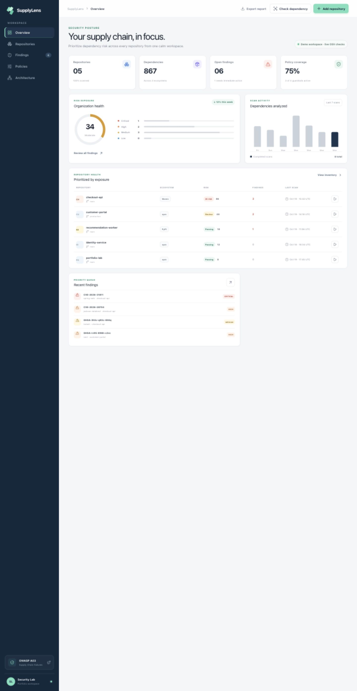
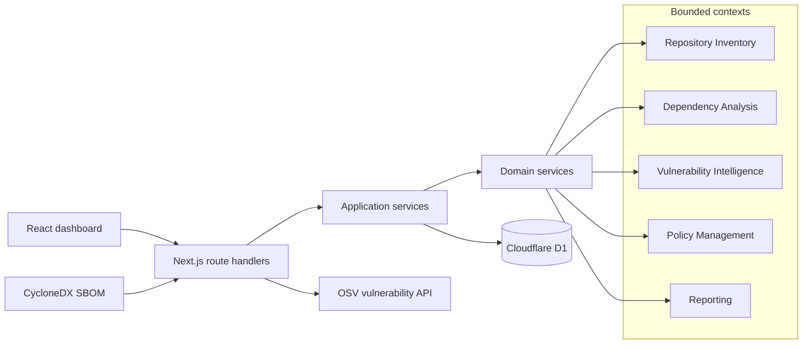

# SupplyLens

SupplyLens is a full-stack software supply-chain security dashboard. It helps a development team inventory repositories, understand direct and transitive dependency exposure, run repeatable scans, and turn security standards into release policies.

The project was designed as a second-year software-engineering portfolio project: the scope is realistic, the domain model is explicit, and the architecture avoids unnecessary distributed-system complexity.



## Why this project

Software supply-chain failures are listed as **A03 in the OWASP Top 10:2025**. Modern applications rely on hundreds of direct and transitive packages, so teams need visibility into what they ship and a consistent way to prioritize remediation.

## Features

- Repository inventory across npm, Maven, and PyPI projects
- Persistent scan history and risk posture in Cloudflare D1
- Immutable audit events for repository, scan, and policy mutations
- Vulnerability queue ordered by severity and exposure
- Direct versus transitive dependency paths
- CycloneDX SBOM ingestion with a 500-component and 512 KB safety limit
- Dependency-graph analysis with breadth-first depth, shortest exposure paths, cycle detection, isolated-node detection, and license coverage
- Interactive dependency graph with search, relationship filters, severity signals, and a component inspector
- Normalized PURL-indexed component inventory and persisted dependency edges
- Live package-version checks against the public OSV API
- Automated policy gate with PASS, FAIL, or REVIEW REQUIRED decisions and evidence
- Aggregate scan comparison showing introduced, resolved, and unchanged exposure without fabricating package-level history
- Explainable remediation drawer with dependency path, CVSS context, and safe upgrade guidance
- Security alert center and risk-posture timeline derived from persisted scans and audit events
- JSON security-report export
- Premium responsive dark/light interface with command palette, repository, findings, SBOM, policy, alert, comparison, and architecture views
- Seeded demo workspace for immediate evaluation
- Typed request contracts, structured API errors, and a database health endpoint

> The preloaded findings are illustrative portfolio data. The **Check dependency** workflow performs a live OSV query and displays current results returned by the service.

## Architecture



SupplyLens is a **modular monolith**. It has one deployable unit and one transactional database, while domain boundaries remain explicit in the source. This provides a clean path to future service extraction without the operational cost of premature microservices.

## Technology

- Next.js 16 and React 19
- TypeScript
- Cloudflare Workers and D1
- Drizzle ORM and generated SQL migrations
- Zod request validation
- OSV vulnerability API
- Node.js built-in test runner
- GitHub Actions
- Accessible responsive CSS

## Local development

Requirements: Node.js 22.13 or newer.

```bash
npm ci
npm run db:generate
npm run build
node --import ./scripts/sites-env.mjs ./node_modules/wrangler/bin/wrangler.js d1 execute DB --local --config dist/server/wrangler.json --persist-to .wrangler/state --file drizzle/0000_*.sql
node --import ./scripts/sites-env.mjs ./node_modules/wrangler/bin/wrangler.js d1 execute DB --local --config dist/server/wrangler.json --persist-to .wrangler/state --file drizzle/0001_*.sql
node --import ./scripts/sites-env.mjs ./node_modules/wrangler/bin/wrangler.js d1 execute DB --local --config dist/server/wrangler.json --persist-to .wrangler/state --file drizzle/0002_*.sql
npm run dev
```

Run the domain tests:

```bash
npm test
```

Run static checks and a production build:

```bash
npm run lint
npm run build
```

## API workflows

| Endpoint | Method | Purpose |
| --- | --- | --- |
| `/api/dashboard` | `GET` | Aggregate dashboard, policy-gate, and scan-comparison read model |
| `/api/health` | `GET` | Verify the API and D1 connection |
| `/api/repositories` | `POST` | Add a repository and baseline scan |
| `/api/scans` | `POST` | Run and persist a repository scan |
| `/api/policies` | `PATCH` | Enable or pause a policy |
| `/api/osv` | `POST` | Query live OSV advisories |
| `/api/sbom` | `POST` | Validate, analyze, and persist a CycloneDX dependency graph |

## Engineering evidence

- [Architecture](docs/ARCHITECTURE.md)
- [Domain model](docs/DOMAIN-MODEL.md)
- [ADR 001: Modular monolith](docs/adr/001-modular-monolith.md)
- [Test strategy](docs/TEST-STRATEGY.md)
- [LinkedIn launch kit](docs/LINKEDIN-POST.md)

## Security and limitations

- External package input is length- and ecosystem-validated before OSV requests.
- Strict Zod contracts reject unknown fields, invalid identifiers, and unsupported ecosystems.
- SBOM bodies are capped at 512 KB and 500 components before graph processing; duplicate references and unsupported formats are rejected.
- The OSV client has an eight-second timeout and normalizes upstream failures without exposing internals.
- Mutations write append-only audit events for traceability.
- No repository credentials or source code are collected.
- The project currently analyzes package/version coordinates rather than cloning repositories.
- Authentication is provided by the private Sites deployment. A production multi-tenant version would add organization-scoped authorization to every record.

## License

MIT
