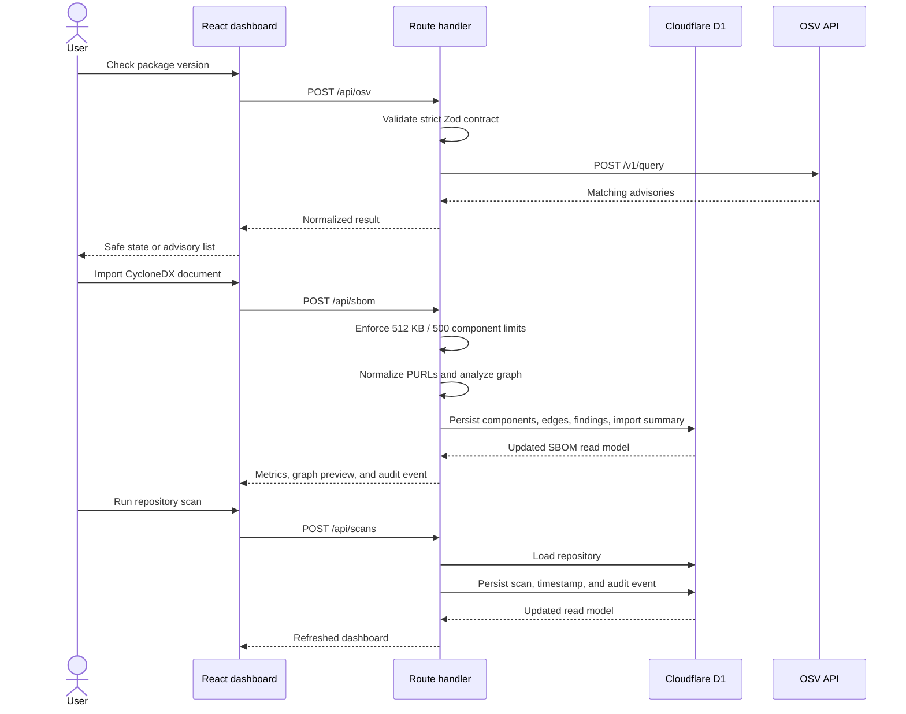

# Architecture

## Quality goals

1. **Understandable:** a new contributor can trace a request without crossing deployment boundaries.
2. **Testable:** risk scoring and graph traversal remain independent from React, HTTP, and persistence.
3. **Reliable:** relational constraints protect scan and finding history.
4. **Extensible:** each bounded context can evolve without mixing unrelated responsibilities.
5. **Deployable:** one build produces one Cloudflare Worker and a D1 migration set.

## Layers

| Layer | Responsibility | Examples |
| --- | --- | --- |
| Presentation | Interaction and responsive visualization | `app/dashboard.tsx`, `components/supplylens/` |
| Application | Validate commands and coordinate use cases | `server/*-service.ts`, `server/contracts.mjs` |
| Domain | Business calculations and graph algorithms | `domain/risk-engine.mjs`, `domain/sbom-analyzer.mjs` |
| Infrastructure | Persistence and external services | `db/`, D1, OSV API |

Dependencies point inward: the domain layer does not import framework or persistence code.

## Runtime flow

## Deployment

The Next.js-compatible application is compiled by Vinext into a Cloudflare Worker. D1 migrations are applied before the worker version is activated. The public OSV API is accessed only from the server route, keeping integration behavior consistent and avoiding browser CORS concerns.

## Reliability controls

- Route handlers stay thin and return consistent `{ error, code }` failures.
- Application services own repository, scan, policy, and audit workflows.
- Strict request schemas reject unknown or malformed fields before persistence.
- Foreign keys and unique constraints protect the relational model.
- External OSV calls use a bounded timeout and normalized 502/503 responses.
- `/api/health` performs an actual D1 query rather than returning a static status.
- SBOM analysis completes validation before persistence, detects cycles, and batches dense edge writes below D1 bind limits.

## Deliberate tradeoffs

- A modular monolith was selected over microservices because the domain and team size do not justify network boundaries.
- D1 keeps the deployment small and portable; PostgreSQL would be appropriate for heavier analytical workloads.
- CycloneDX JSON is supported today; SPDX and scheduled repository ingestion remain future increments.
- Imports replace the selected repository's current normalized graph while preserving historical scan and audit records.
